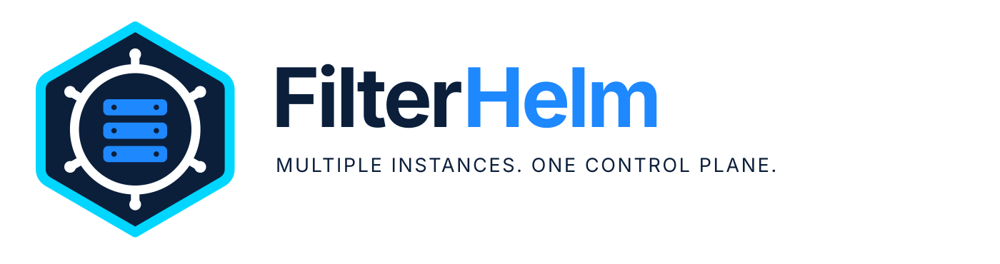

<picture>
  <source media="(prefers-color-scheme: dark)" srcset="branding/logos/filterhelm-horizontal-dark.svg" />
  
</picture>

# FilterHelm

Multiple instances. One control plane.

An independent, third-party management platform for Pi-hole instances. Not affiliated with or endorsed by Pi-hole.

Local(ish) GUI for managing multiple Pi-hole instances — cross-instance DNS
record comparison, adlist management, domain allow/deny overrides, group and client management, and per-instance settings.

**Status: deployed with instance, local DNS, and settings management.**

Design doc, requirements, and layout mockups: [`docs/design.md`](docs/design.md).

## Why this exists

A home or small-office network might have multiple pihole instances for
high availability. These would need items such as DNS records, adlists, and settings 
kept in sync with each other in such a way that doesn't have a negative impact to the 
environment. Tools exist that sync up multiple instances, but these seem to cause 
stability problems, or don't give a way to call out differences. (e.g.,  they might 
corrupt the gravity database, or muck up FTL with restarts).  This is a tool that 
gives you more control over managing multiple instances, with a goal of minimal risk
to stability. 

## Stack

Python/FastAPI backend with a React, TypeScript, Vite, and Ant Design frontend.
FastAPI helps provide credentials, Pi-hole API access, mutation safety, and auditing;
giving the browser a single endpoint to talk to `/api` endpoints. The compiled frontend is
created under `app/static/ui` so the Python-only deployment target does not need Node.js.

Run the application:

```bash
./.venv/bin/pip install -r requirements.lock
./.venv/bin/pip install --no-deps --no-build-isolation -e .
./.venv/bin/uvicorn app.main:app --host 127.0.0.1 --port 8420
```

Then open `http://127.0.0.1:8420/`.

Or with containers:

```bash
docker compose up -d --build
docker compose exec filterhelm python -m app.auth set-password --username admin
```

You can also use `podman compose`. Then open `http://127.0.0.1:8420/`.
For production deployment, see [docs/deploy.md](docs/deploy.md).

### Authentication

Authentication is required and defaults to local mode. Before the first
login, create or reset an administrator from the server console. In production,
run it inside the container so its user and `/data` directory match the service:

```bash
sudo podman exec -it filterhelm python -m app.auth set-password --username admin
```

Local passwords are Argon2id-hashed in the private `auth.db` data file.
Sessions, server-side and have an idle timeout of 30 minutes. They will outright 
expire after eight hours, and use `HttpOnly; Secure; SameSite=Strict` cookies. 
The web UI detects an expired session on the next request and redirects to the sign-in screen
automatically. Any background status polling does not count as activity to prevent
unattended tab from creating a zombie session. Since cookies are secure by
default, production must use HTTPS. For loopback-only HTTP development, set
`FILTERHELM_COOKIE_SECURE=false`.

Five failed login attempts within 15 minutes will lock the account.
The direct client address is recorded for audit but does not gate login attempts, 
because a reverse proxy makes that address common to every account. 
This leaves a targeted single-account lockout possible; proxy-level
login limits are recommended and stack with the application-wide request limit.

To delegate authentication to a reverse proxy instead:

```ini
FILTERHELM_AUTH_MODE=proxy
FILTERHELM_PROXY_HEADER=Remote-User
FILTERHELM_PROXY_TRUSTED_IPS=127.0.0.1,192.0.2.10/32
FILTERHELM_PROXY_USERS=user,operator
```
--- below unsanitized ---

The proxy must remove any client-supplied identity header and set its own only
after successful authentication. Requests carrying identity are accepted only
from `FILTERHELM_PROXY_TRUSTED_IPS` (comma-separated IPs/CIDRs), and the
proxy should still be the only host allowed to reach Uvicorn.
`FILTERHELM_PROXY_USERS` is optional; an empty value accepts any non-empty
identity supplied by the trusted proxy. Local and proxy modes are mutually
exclusive and never fall back to one another.

Frontend development uses two terminals:

```bash
./.venv/bin/uvicorn app.main:app --host 127.0.0.1 --port 8420
cd frontend && npm install && npm run dev
```

Vite proxies `/api` to FastAPI. Before committing frontend changes, run:

```bash
cd frontend
npm run lint
npm run build
npm test
```

The build writes directly to `app/static/ui`; include those generated changes
in the same commit as the frontend source.

Backend checks:

```bash
./.venv/bin/pip install -e '.[dev]'
./.venv/bin/pytest -q
```

### Request integrity

All `POST`, `PUT`, `PATCH`, and `DELETE` requests must include an `Origin` or
`Referer` whose host matches the request's `Host` header. Cross-site Fetch
Metadata is rejected as well. A reverse proxy must preserve the public
`Host` header. Non-browser API clients must send an appropriate `Origin`, for
example `Origin: https://manager.example` when calling that host.

CSRF/origin enforcement remains active in both authentication modes.

Authentication successes, failures, throttling, logouts, backup downloads, FTL service actions, and
configuration mutations are recorded in the private `0600` audit log. The log contains
usernames, client addresses for login events, DNS names, IP addresses, and
changed setting values; it never records passwords or session tokens.
Signed-in users can read and filter it on the Audit log page.

### HTTP hardening

Dynamic requests are limited to 120 requests per 60-second sliding window,
keyed by authenticated username or, before authentication, the direct client
address. Static `/app` and `/static` assets are excluded. Request bodies are
limited to 1 MiB whether or not the client supplies `Content-Length`.

The defaults can be changed with positive integer values:

```ini
FILTERHELM_MAX_BODY_BYTES=1048576
FILTERHELM_RATE_LIMIT_REQUESTS=120
FILTERHELM_RATE_LIMIT_WINDOW_SECONDS=60
FILTERHELM_FANOUT_WORKERS=8
```

The fan-out worker setting bounds the request-scoped thread pools used when the
instances, status, block-list, and local-DNS list endpoints query independent
Pi-hole instances concurrently.

The application accepts only configured HTTP `Host` values. The secure
default is `localhost,127.0.0.1,testserver`; production deployments must add
their public hostname. Entries use Starlette's exact-host and leading
`*.` wildcard syntax:

```ini
FILTERHELM_TRUSTED_HOSTS=manager.example,*.internal.example,127.0.0.1
```

Do not use `*` in production. This list controls inbound `Host` headers and
is separate from `FILTERHELM_PUBLIC_ALLOWLIST`, which controls outbound
Pi-hole destinations.

Responses include a same-origin Content Security Policy, HSTS, clickjacking,
MIME-sniffing, referrer, and browser-permission restrictions. HSTS is ignored
by browsers over development HTTP and takes effect when the application is
served over HTTPS.

The application rate limiter is process-local. Deployments with multiple
Uvicorn workers must enforce the aggregate limit at the reverse proxy or use
a future shared-state limiter. Before authentication, a reverse proxy also
makes its own address the application-visible rate key; proxy-level login
limits are recommended in that topology.

### Outbound instance policy

Instance URLs must be origin-only `http` or `https` URLs. Embedded
credentials, paths, query strings, fragments, invalid ports, control
characters, and ambiguous backslash forms are rejected. Redirect following
is disabled, so Pi-hole credentials and session headers cannot be redirected
to another origin.

By default, destinations must resolve entirely into IPv4 RFC1918 space
(`10.0.0.0/8`, `172.16.0.0/12`, or `192.168.0.0/16`) or IPv6 unique-local
space (`fc00::/7`). Loopback, link-local, cloud-metadata, multicast,
unspecified, and reserved destinations are always denied. Mixed private and
unapproved public DNS answers are denied.

Public destinations require a comma-separated allowlist. Entries may be
exact hostnames, exact IPv4/IPv6 addresses, or IPv4/IPv6 CIDRs:

```ini
FILTERHELM_PUBLIC_ALLOWLIST=pihole.example.com,198.51.100.1,2001:db8:ab09::3574
```

Hostname entries match exactly; they do not implicitly allow subdomains.
The destination is resolved and checked immediately before constructing the
HTTP client. The client connects to the validated address while retaining the
original hostname for TLS verification, SNI, and the HTTP `Host` header,
closing the DNS-rebinding/time-of-check-to-time-of-use gap for Pi-hole API
requests. New block-list URLs are validated for HTTP(S) syntax and canonicalized;
embedded credentials, control characters, fragments, and literal-IP hosts in
prohibited ranges are rejected. They are not resolved or subject to
`FILTERHELM_PUBLIC_ALLOWLIST`, because Pi-hole, not this app, fetches them.
Update, delete, and bulk inputs identify existing lists without URL screening.

### Pi-hole compatibility

FilterHelm supports the Pi-hole FTL 6.x REST API. The Instances page
reads `/api/info/version` and displays the detected Core, Web, FTL, and Docker
versions. FTL 5.x is reported as incompatible; a future FTL major version is
reported as untested until compatibility is confirmed. The Health column reads
`/api/info/system`, `/api/info/ftl`, `/api/info/database`, and `/api/info/sensors`
for host and FTL uptime, memory, swap, load, CPU, temperature, FTL usage, and database size.
A status dot summarises the result: warning within 5 degrees of Pi-hole's temperature limit, at
80% RAM, 50% swap, or a 1-minute load of one per core; critical at the temperature
limit, 95% RAM, or two per core.

Update availability uses the local and remote versions reported by Pi-hole
itself. If Pi-hole cannot obtain remote version metadata, the manager leaves
the update state unknown rather than making its own external version request.

The Status page shows whether blocking is active on each instance. Blocking
can be paused on one instance or a selected group for 10 seconds, 30 seconds,
5 minutes, or indefinitely, and resumed explicitly at any time. Group changes
run sequentially and report partial failures rather than hiding successful
changes on other instances. Every successful blocking change is audited.

The Block Lists page presents subscribed deny lists in one cross-instance
table, including enabled state, domain count, last update, missing lists, and
enabled-state conflicts. Lists can be added to one or several instances,
copied to a missing instance, enabled, disabled, or removed. These operations
change Pi-hole's list configuration but deliberately do not run gravity.
Instances with pending changes are tracked in the private application data
directory and expose a separate, confirmed **Update gravity** action. A
successful gravity update clears that instance's pending state; failures
leave it pending for a retry.

The Lookup page calls Pi-hole's `/api/search` on every instance and derives a
per-instance blocked, allowed, or not-listed verdict from enabled matching entries
in FTL precedence order. It shows domain and gravity matches with group names;
group-scoped entries may not apply to every client. Partial searches and truncated
exact searches show matches and counts without a verdict. Lookups are read-only
and run only when submitted.

The Queries page reads `/api/stats/summary`, `/api/stats/top_domains`,
`/api/stats/top_clients`, `/api/stats/upstreams`, and `/api/queries` on every
instance and merges the query log newest-first. It shows filtered recent queries
alongside per-instance 24-hour statistics and is read-only, loading on open and
on Apply or Refresh.

## Status / next step

Implemented: **instance/status management (§5.1)**, the unified **Local DNS view and
record management (§5.2)**, unified **block-list management (§5.3)**, and scoped
**settings management (§5.4)**. Local
DNS uses Pi-hole v6's item-level `dns.hosts` operations so one record is
mutated at a time rather than replacing the full list.

## TODO

- Git history still carries internal addresses and endpoints; see
  [docs/design.md §14](docs/design.md#14-public-release-readiness).
- see [potential-features](docs/potential-features.md)

## Upgrading from pihole-manager

- Rename `PIHOLE_MANAGER_*` environment variables to `FILTERHELM_*`.
- Local installs run `mv ~/.config/pihole-manager ~/.config/filterhelm`.
- Keyring users re-enter instance app passwords.
- Compose users get a new volume, so copy data from `pihole-manager-data` or start fresh.
- Everyone signs in again.
