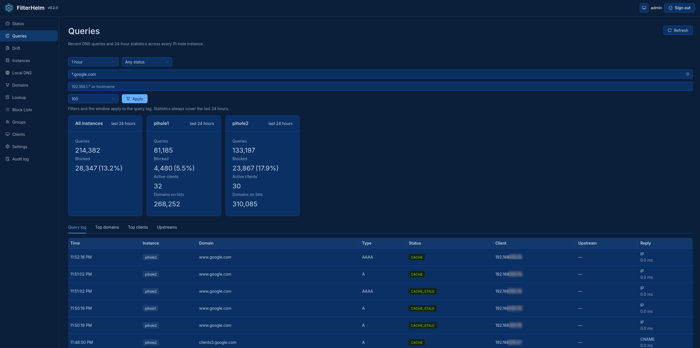
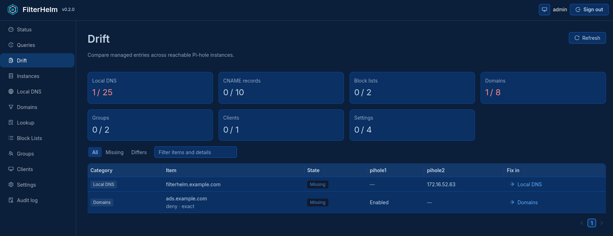
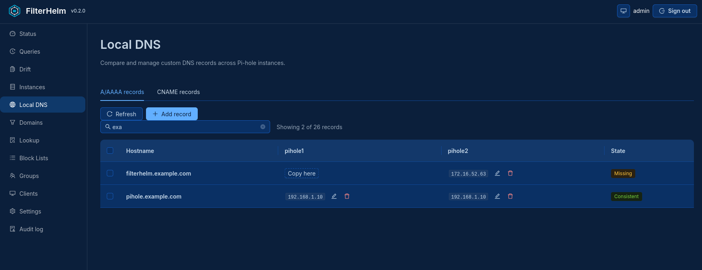
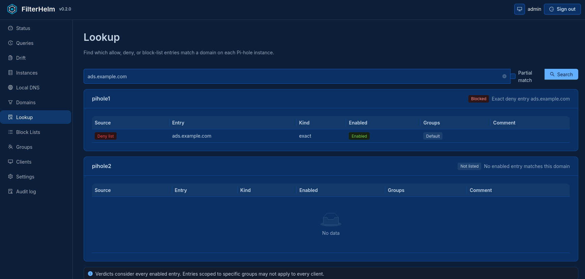

<picture>
  <source media="(prefers-color-scheme: dark)" srcset="branding/logos/filterhelm-horizontal-dark.svg" />
  
</picture>

# FilterHelm

Multiple instances. One control plane.

[Documentation and getting started](https://filterhelm.nulthara.com).

FilterHelm is a self-hosted web app for managing several Pi-hole instances from one place.
It compares DNS records, block lists, domain overrides, groups, and clients across
instances, and changes them one instance at a time.

FilterHelm is an independent, third-party project. It is not affiliated with or endorsed
by Pi-hole.

## Why this exists

Home and small-office networks often run two or more Pi-hole instances for redundancy.
Those instances need the same DNS records, block lists, and settings. Existing sync tools
copy whole configurations between instances. That can corrupt the gravity database,
restart FTL at bad moments, or hide the differences you wanted to see.

FilterHelm takes a slower, safer approach:

- Show differences between instances before changing anything.
- Change one record on one instance at a time.
- Never run gravity or restart FTL without an explicit, confirmed action.
- Run nothing in the background.

## Features

| Page | What it does |
| --- | --- |
| Status | Shows blocking state per instance; pauses or resumes blocking on one instance or several |
| Queries | Merges recent query logs from every instance and shows 24-hour statistics |
| Drift | Lists managed entries that differ between instances |
| Instances | Adds and removes instances, shows versions and health, downloads Teleporter backups |
| Local DNS | Compares and edits custom DNS host and CNAME records |
| Domains | Manages allow and deny overrides |
| Lookup | Shows whether each instance blocks, allows, or ignores a domain |
| Block Lists | Manages subscribed lists and triggers gravity updates on request |
| Groups | Manages filtering groups |
| Clients | Manages clients and their group membership |
| Settings | Reviews and updates a small set of settings on one instance |
| Audit log | Shows every sign-in and configuration change |

### Query Page


### Drift Page


### Managing DNS across Pi-holes


### Find where a Domain is blocked from



More detail on individual pages is in [Page behavior](#page-behavior). The design doc,
requirements, and layout mockups are in [docs/design.md](docs/design.md).

## Quick start

### Run locally

Requires Python 3.11 or newer.

```bash
python3 -m venv .venv
./.venv/bin/pip install -r requirements.lock
./.venv/bin/pip install --no-deps --no-build-isolation -e .
./.venv/bin/python -m app.auth set-password --username admin
FILTERHELM_COOKIE_SECURE=false ./.venv/bin/uvicorn app.main:app --host 127.0.0.1 --port 8420
```

Open `http://127.0.0.1:8420/` and sign in. `FILTERHELM_COOKIE_SECURE=false` allows sign-in
over plain HTTP. Use it only on loopback.

### Run the published image

Images for `amd64` and `arm64` are published to `ghcr.io/nulthara/filterhelm`.

```bash
docker run -d --name filterhelm --read-only --tmpfs /tmp \
  -p 127.0.0.1:8420:8420 \
  -e FILTERHELM_COOKIE_SECURE=false \
  -v filterhelm-data:/data \
  ghcr.io/nulthara/filterhelm:latest
docker exec -it filterhelm python -m app.auth set-password --username admin
```

Pin a version tag such as `0.2.1` instead of `latest` for anything long-lived.

### Run with Compose

Download the standalone [Compose sample](compose.ghcr.yaml) and start the published image:

```bash
curl -fsSLO https://raw.githubusercontent.com/nulthara/filterhelm/main/compose.ghcr.yaml
docker compose -f compose.ghcr.yaml up -d
docker compose -f compose.ghcr.yaml exec filterhelm python -m app.auth set-password --username admin
```

Open `http://127.0.0.1:8420/` and sign in. If you rename the file to `compose.yaml`,
you can drop `-f compose.ghcr.yaml` from the commands.

### Verify an image

Each release image carries signed build provenance and an SPDX SBOM describing the
`amd64` image. Verify them with:

```bash
gh attestation verify oci://ghcr.io/nulthara/filterhelm:X.Y.Z --owner nulthara
gh attestation verify oci://ghcr.io/nulthara/filterhelm:X.Y.Z --owner nulthara \
  --predicate-type https://spdx.dev/Document/v2.3
```

### Run in a container from a clone

```bash
docker compose up -d --build
docker compose exec filterhelm python -m app.auth set-password --username admin
```

`podman compose` works the same way. Open `http://127.0.0.1:8420/`.

For production deployment, see [docs/deploy.md](docs/deploy.md). For backups and
upgrades, see [docs/upgrade-and-backup.md](docs/upgrade-and-backup.md).

## Security

Report vulnerabilities privately, as described in [SECURITY.md](SECURITY.md).

### Credential storage

Pi-hole passwords stay on the server and never reach the browser. FilterHelm stores them
in the OS keyring when one exists. Containers and headless hosts have no keyring, so the
passwords go in `secrets.yml` in the data directory. File permissions (`0600`) protect
that file, but it is not encrypted. Protect the data directory and its backups
accordingly.

### Authentication

FilterHelm always requires sign-in. It supports two modes, local and proxy. The modes are
mutually exclusive, and neither falls back to the other.

**Local mode** is the default. Create or reset an administrator from the server console
before the first sign-in. In production, run the command inside the container so it uses
the service's user and `/data` directory:

```bash
sudo podman exec -it filterhelm python -m app.auth set-password --username admin
```

- Passwords are hashed with Argon2id and stored in the private `auth.db` data file.
- Sessions are stored on the server. They end after 30 minutes idle or eight hours total.
- Session cookies are `HttpOnly; Secure; SameSite=Strict`, so production must use HTTPS.
- The web UI notices an expired session on the next request and returns to the sign-in
  screen.
- Background status polling does not count as activity, so an unattended tab still times
  out.
- Five failed sign-ins within 15 minutes lock the account.

Lockout is per account, not per client address. Behind a reverse proxy every client shares
the proxy's address, so per-address limits would lock everyone out at once. The trade-off
is that an attacker can lock out a single account deliberately. Add sign-in rate limits at
the proxy to reduce that risk. Proxy limits stack with the application's own request
limit.

**Proxy mode** delegates authentication to a reverse proxy:

```ini
FILTERHELM_AUTH_MODE=proxy
FILTERHELM_PROXY_HEADER=Remote-User
FILTERHELM_PROXY_TRUSTED_IPS=127.0.0.1,192.0.2.10/32
FILTERHELM_PROXY_USERS=user,operator
```

- The proxy must strip any identity header sent by the client, then set its own only after
  successful authentication.
- FilterHelm accepts the identity header only from addresses in
  `FILTERHELM_PROXY_TRUSTED_IPS` (comma-separated IPs or CIDRs).
- The proxy should be the only host that can reach Uvicorn.
- `FILTERHELM_PROXY_USERS` is optional. Leave it empty to accept any non-empty identity
  from the trusted proxy.

### Request integrity

Every `POST`, `PUT`, `PATCH`, and `DELETE` request must carry an `Origin` or `Referer`
whose host matches the request's `Host` header. FilterHelm also rejects requests whose
Fetch Metadata marks them as cross-site. These checks apply in both authentication modes.

- A reverse proxy must preserve the public `Host` header.
- Non-browser API clients must send a matching `Origin`, such as
  `Origin: https://manager.example`.

### Audit log

FilterHelm writes a private audit log with `0600` permissions. It records:

- sign-in successes, failures, lockouts, and sign-outs
- backup downloads
- FTL service actions
- configuration changes

Entries include usernames, client addresses for sign-in events, DNS names, IP addresses,
and changed setting values. The log never records passwords or session tokens. Signed-in
users can read and filter it on the Audit log page.

### HTTP hardening

Defaults:

- 120 dynamic requests per 60-second sliding window, keyed by username, or by client
  address before sign-in. Static `/app` and `/static` assets are not counted.
- 1 MiB maximum request body, whether or not the client sends `Content-Length`.
- 8 worker threads for endpoints that query several instances at once.

Override them with positive integers:

```ini
FILTERHELM_MAX_BODY_BYTES=1048576
FILTERHELM_RATE_LIMIT_REQUESTS=120
FILTERHELM_RATE_LIMIT_WINDOW_SECONDS=60
FILTERHELM_FANOUT_WORKERS=8
```

The rate limiter keeps its counts in process memory. If you run several Uvicorn workers,
enforce the overall limit at the reverse proxy.

FilterHelm accepts only configured `Host` header values. The default is
`localhost,127.0.0.1,testserver`, so production deployments must add their public
hostname. Entries are exact hosts or leading `*.` wildcards:

```ini
FILTERHELM_TRUSTED_HOSTS=manager.example,*.internal.example,127.0.0.1
```

Do not use `*` in production. This setting controls inbound requests only. Outbound
Pi-hole destinations are controlled separately by `FILTERHELM_PUBLIC_ALLOWLIST`.

Responses include a same-origin Content Security Policy, HSTS, and headers that block
clickjacking, MIME sniffing, referrer leaks, and unneeded browser features. Browsers ignore
HSTS over plain HTTP, so it takes effect only once the app is served over HTTPS.

### Outbound instance policy

Instance URLs must be bare `http` or `https` origins. FilterHelm rejects URLs with embedded
credentials, paths, query strings, fragments, invalid ports, control characters, or
ambiguous backslashes. It never follows redirects, so Pi-hole credentials cannot be sent
to a different origin.

By default, an instance hostname must resolve only to private addresses:

- IPv4 `10.0.0.0/8`, `172.16.0.0/12`, or `192.168.0.0/16`
- IPv6 unique-local `fc00::/7`

Loopback, link-local, cloud-metadata, multicast, unspecified, and reserved addresses are
always denied. A hostname that resolves to a mix of private and unapproved public addresses
is denied too.

To allow a public destination, list it in `FILTERHELM_PUBLIC_ALLOWLIST`. Entries may be
exact hostnames, IPv4 or IPv6 addresses, or CIDRs. Hostnames match exactly and do not
cover subdomains.

```ini
FILTERHELM_PUBLIC_ALLOWLIST=pihole.example.com,198.51.100.1,2001:db8:ab09::3574
```

FilterHelm resolves and checks the destination immediately before each connection, then
connects to the checked address. It keeps the original hostname for TLS verification, SNI,
and the `Host` header. This closes the gap a DNS-rebinding attack would use.

Block-list URLs follow lighter rules, because Pi-hole fetches them, not FilterHelm. New
list URLs must be valid HTTP(S). FilterHelm normalizes them and rejects embedded
credentials, control characters, fragments, and literal IPs in denied ranges. It does not
resolve them or check them against the allowlist. Update, delete, and bulk actions refer to
existing lists and skip URL checks.

## Pi-hole compatibility

FilterHelm supports the Pi-hole FTL 6.x REST API.

- FTL 5.x is reported as incompatible.
- A newer FTL major version is reported as untested until someone confirms it works.
- Update availability comes from Pi-hole's own version check. If Pi-hole cannot reach its
  update server, FilterHelm shows the update state as unknown and makes no external request
  of its own.

## Page behavior

**Instances.** Reads `/api/info/version` for Core, Web, FTL, and Docker versions. The Health
column reads `/api/info/system`, `/api/info/ftl`, `/api/info/database`, and
`/api/info/sensors`, and summarizes them as a status dot:

| Level | Temperature | RAM | Swap | 1-minute load |
| --- | --- | --- | --- | --- |
| Warning | within 5° of Pi-hole's limit | 80% | 50% | 1 per core |
| Critical | at Pi-hole's limit | 95% | — | 2 per core |

**Status.** Pauses blocking on one instance or several for 10 seconds, 30 seconds,
5 minutes, or indefinitely, and resumes it at any time. Multi-instance changes run one
instance at a time. If some instances fail, the page reports which ones and keeps the
successful changes.

**Block Lists.** Shows every subscribed deny list in one table, with enabled state, domain
count, last update, and which instances are missing a list or disagree on whether it is
enabled. Adding, copying, enabling, disabling, or removing a list does not run gravity.
Instead, the instance is marked as having pending changes, and a separate, confirmed
**Update gravity** action applies them. A failed update leaves the instance pending so you
can retry.

**Local DNS.** Uses Pi-hole v6's item-level `dns.hosts` operations, so each change touches
one record instead of replacing the whole list.

**Lookup.** Calls `/api/search` on every instance and works out a blocked, allowed, or
not-listed verdict from enabled matches in FTL's precedence order. Group-scoped entries
may not apply to every client. Partial searches, and exact searches with truncated
results, show matches without a verdict. Lookups are read-only and run only when submitted.

**Queries.** Reads summary, top-domain, top-client, upstream, and query-log endpoints from
every instance and merges the logs newest first. The page is read-only and loads only when
opened or when you click Apply or Refresh.

## Development

The backend is Python and FastAPI. It holds the Pi-hole credentials, calls the Pi-hole
APIs, enforces change safety, and writes the audit log. The frontend is React, TypeScript,
Vite, and Ant Design, and it talks only to the backend's `/api`. The built frontend is
committed under `app/static/ui`, so deployment needs Python but not Node.js.

Run the backend and the Vite dev server in two terminals:

```bash
./.venv/bin/uvicorn app.main:app --host 127.0.0.1 --port 8420
cd frontend && npm install && npm run dev
```

Vite forwards `/api` requests to FastAPI.

Before committing frontend changes, run the checks and build:

```bash
cd frontend
npm run lint
npm run build
npm test
```

The build writes to `app/static/ui`. Commit those generated files together with the
frontend source.

Backend tests:

```bash
./.venv/bin/pip install --require-hashes -r requirements.lock -r requirements-dev.lock
./.venv/bin/pip install --no-deps --no-build-isolation -e .
./.venv/bin/pytest -q
```

To contribute, see [CONTRIBUTING.md](CONTRIBUTING.md).

## How this is built

FilterHelm is developed with AI coding agents under human direction. Claude
writes a plan for each change, Codex implements it, and Claude reviews the
diff against the plan and the project's safety rules. I review and approve
every merge. The process is described in [ARCHITECT.md](ARCHITECT.md), and
each change's plan is in [docs/plans/](docs/plans/).

## Roadmap

Planned and candidate features are listed in
[docs/potential-features.md](docs/potential-features.md).

## License

FilterHelm is released under the [MIT License](LICENSE).
